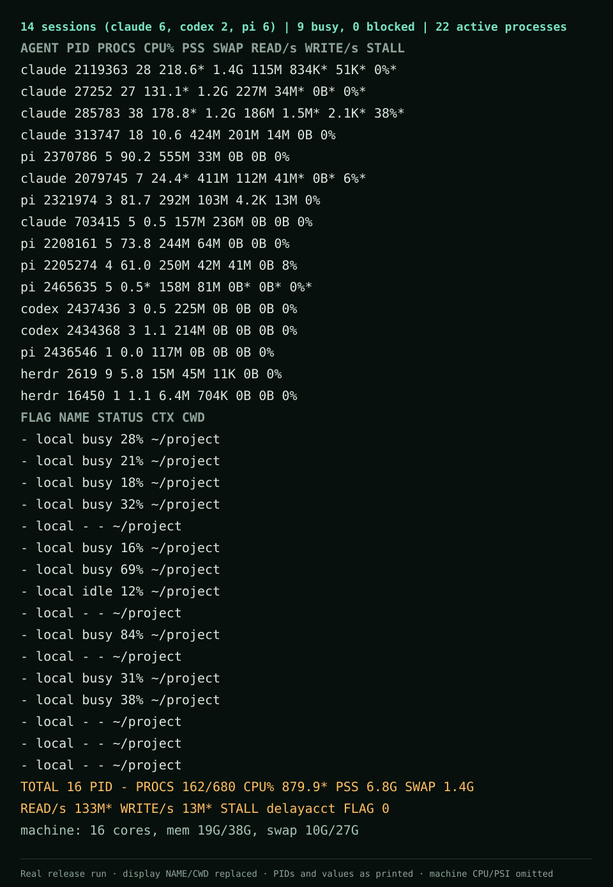

<p align="center">
  
</p>

<h1 align="center">AgentCenter</h1>

<p align="center"><strong>Know what every coding agent costs your machine.</strong></p>

<p align="center">
  <a href="https://github.com/eduardopin/agentcenter/actions/workflows/ci.yml"></a>
  <a href="LICENSE"></a>
  <a href="docs/KNOWN_LIMITATIONS.md"></a>
</p>

<p align="center">
  <a href="https://eduardopin.github.io/agentcenter/">Website</a> ·
  <a href="docs/ARCHITECTURE.md">Architecture</a> ·
  <a href="CONTRIBUTING.md">Contributing</a>
</p>

<p align="center">
  
</p>

<p align="center"><sub>Real output from a release build. Session name and working directory anonymized.</sub></p>

## Quick install

```sh
git clone https://github.com/eduardopin/agentcenter.git
cd agentcenter
bash install.sh
```

Linux only. This builds and installs the GTK desktop app and headless CLI for
your user. See [install details](#install-details) for dependencies, paths, and
uninstall options.

> **Pre-alpha:** current validation has failing performance gates and incomplete
> action acceptance. Read the [known limitations](docs/KNOWN_LIMITATIONS.md)
> before relying on AgentCenter.

**Help wanted:** follow [Your first contribution](CONTRIBUTING.md#your-first-contribution)
or browse [good first issues](https://github.com/eduardopin/agentcenter/issues?q=is%3Aissue%20is%3Aopen%20label%3A%22good%20first%20issue%22).

## What it measures

AgentCenter shows what each Claude Code, Codex, pi, Copilot, Kiro, Gemini or
opencode session costs your machine: CPU, memory (PSS + swap), disk throughput
and I/O stall, per session and per child process (MCP servers, shells, builds),
live, with a GTK4 + libadwaita interface. Its performance budgets are targets,
not guarantees for the current build.

The desktop app is `agentcenter`; `agentcenter-cli` is the headless front end.
See [docs/ARCHITECTURE.md](docs/ARCHITECTURE.md) for the design.

## Install details

Linux only for now. From a checkout of this repository, one command builds
both programs and installs them for your user, with an `AgentCenter` entry in
the app menu:

```sh
bash install.sh
```

It needs Rust from [rustup](https://rustup.rs) (stable, at least the
`rust-version` in `Cargo.toml`), a C linker, `pkg-config`, GTK >= 4.22 and
libadwaita >= 1.9 (Ubuntu 26.04 ships both). When a build library is missing
it prints the exact `apt-get` line; `bash install.sh --deps` runs it with
`sudo`. Then open AgentCenter from the menu, or run `agentcenter` (the
installer puts it in `~/.local/bin`).

| What | Where (default prefix `~/.local`) |
|---|---|
| `agentcenter`, `agentcenter-cli` | `~/.local/bin` |
| menu entry | `~/.local/share/applications/io.github.eduardopin.AgentCenter.desktop` |
| icon | `~/.local/share/icons/hicolor/scalable/apps/` |
| settings schema | `~/.local/share/glib-2.0/schemas/` |
| list of installed files | `~/.local/share/agentcenter/installed.txt` |

Running it again rebuilds and updates in place. `bash install.sh --uninstall`
removes exactly the files in that list. `--prefix DIR` installs somewhere
else, and `--no-build` installs what is already in `target/release`;
`bash install.sh --help` lists the options.

To build without installing, `cargo build --release -p agentcenter -p
agentcenter-cli` leaves both binaries in `target/release/`.

## Usage

```sh
agentcenter-cli snapshot                     # one row per AI session
agentcenter-cli snapshot --json              # same snapshot as JSON
agentcenter-cli snapshot --interval-ms 2000  # sample over 2 s instead of 1 s
AGENTCENTER_EXTRA_AGENTS=aider,goose agentcenter-cli snapshot  # extra agents by comm
```

`snapshot` takes two samples `--interval-ms` apart (default 1000) so CPU and
disk rates are real deltas, and prints one row per session: the agent
process plus everything below it. `--proc-root PATH` reads a fixture instead
of `/proc`. `agentcenter-cli snapshot --help` lists the options.

I/O stall per session needs the kernel's task delay accounting. Without it
AgentCenter falls back to counting threads in `D` state. To enable it until
the next boot:

```sh
sudo sysctl kernel.task_delayacct=1
```

## Contributing

See [CONTRIBUTING.md](CONTRIBUTING.md): build and tests, `scripts/ci.sh`,
how to add an adapter or an overlay, and the privacy rules.

## License

Licensed under the [MIT license](LICENSE) (SPDX: `MIT`). Contributions are
accepted under the same license. Third-party code retains its own notices
and license; see [NOTICE](NOTICE) and the Pi integration's
[license](integrations/pi-guarded-compaction/LICENSE.pi).

Earlier revisions were offered under `MIT OR Apache-2.0`; this revision uses
MIT. Existing grants for earlier revisions are unchanged.
